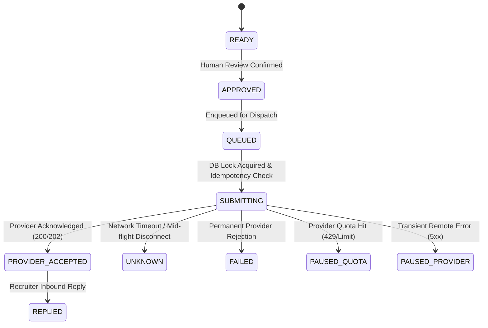

# Automatic Free Email Provider Switching Engine

JobPilot AI incorporates an enterprise-grade, zero-spend automated email provider selection and failover engine. The engine intelligently assigns outbound job applications across authorized free providers, executes zero-duplicate technical failover, respects provider acceptable-use policies, and strictly prohibits anti-abuse evasion tactics.

---

## 1. Architectural Principles

1. **Strict Zero-Spend Free Mode**:
   - Outbound dispatch only selects providers classified as zero-cost free plans.
   - Any paid provider or paid tier is immediately blocked with status `PAID_PROVIDER_BLOCKED`.
   - Universal hardcoded rate caps (such as 200 emails/day) are eliminated in favor of dynamic provider-measured allowances.

2. **No Anti-Abuse Quota Evasion**:
   - JobPilot AI strictly adheres to provider terms of service.
   - **Account rotation prohibition**: Rotating between multiple accounts on the same provider (e.g. alternating between multiple `@gmail.com` addresses) to evade rate limits or daily recipient quotas is explicitly prohibited.
   - **Shared resource awareness**: Google Apps Script and Gmail API sharing the same email address draw from the identical underlying Google mailbox quota. Exhaustion on Gmail API prevents Apps Script from being treated as additive quota.
   - **Suspension respect**: Suspended, throttled, or policy-prohibited accounts are never bypassed through illicit relays.

3. **Two-Stage Switching Classification**:
   - **Technical Failover (Enabled by default)**: Triggered by transient technical anomalies (HTTP 500, 502, 503, 504, network connection drops, timeouts). Immediately retries with backoff and switches to the next eligible alternative.
   - **Quota Exhaustion Switching (Disabled by default)**: When the primary provider reaches its verified daily quota or rate limit (HTTP 429), switching to an independent alternative (e.g. Gmail &rarr; Outlook Graph) is only permitted if the user has explicitly authorized the `allow_quota_switch` toggle. Otherwise, the dispatch halts in `QuotaPaused` status to preserve messages safely.

---

## 2. Standardized Provider Eligibility Statuses

Before evaluating priority order or selecting a dispatch provider, the engine executes an automated health check returning one of eight standardized eligibility statuses:

| Status Code | Description | Automated Switch Permitted |
| :--- | :--- | :---: |
| `ELIGIBLE` | Healthy connection, active authorization, valid free-tier policy, verified quota headroom. | **Yes** |
| `TEMPORARILY_UNAVAILABLE` | Transient network error, remote 5xx server failure, or transient rate limit. | **Failover Eligible** |
| `QUOTA_EXHAUSTED` | Measured or provider-reported daily recipient limit reached. | **Only if user toggle ON** |
| `AUTHENTICATION_REQUIRED` | OAuth token expired, refresh failed, or webhook secret invalid. | **No** |
| `POLICY_NOT_ALLOWED` | Provider terms of service prohibit cold job application outreach (e.g. Mailjet/SMTP2GO). | **Never** |
| `ACCOUNT_SUSPENDED` | Account flagged, disabled, or under provider compliance investigation. | **Never** |
| `QUOTA_UNKNOWN` | Provider does not report quota and local measurement is unavailable. | **Manual Only** |
| `PAID_PROVIDER_BLOCKED` | Provider requires paid subscription or billing auto-upgrade. | **Blocked** |

---

## 3. Provider Priority Hierarchy

Users configure sender hierarchy in **Email Studio &rarr; Provider Priority** or via the **Dashboard Switching Monitor**:

```text
Priority 1: Gmail API (Personal Free Tier — Primary)
Priority 2: Outlook Graph (Consumer Free Tier — Secondary Alternative)
Priority 3: Zoho Mail (Forever Free Plan — Tertiary Alternative)
Optional:   Google Apps Script (Execution Connector, Shared Quota with Gmail)
Prohibited: Mailjet, SMTP2GO (Cold outreach prohibited by acceptable-use policy)
```

### Selection Algorithm:
1. **Manual Mode**: Sends exclusively through the user-specified provider. If that provider is unavailable or exhausted, dispatch halts and notifies the user; no automatic switching occurs.
2. **Automatic Mode**:
   - Inspects enabled accounts ordered by ascending `priority` (1, 2, 3...).
   - Validates eligibility (`evaluateEligibility()`).
   - Filters out accounts sharing the same underlying mailbox with an already exhausted provider.
   - Filters out non-eligible providers.
   - Selects the lowest-priority `ELIGIBLE` account.
   - If no provider is eligible, raises `QuotaExceededException` and transitions pending email to `PausedProvider` or `QuotaPaused`.

---

## 4. Reliable Dispatch State Machine & Duplicate Prevention

To guarantee that no recruiter receives duplicate emails during failovers or retries, JobPilot AI implements an atomic transactional sending lifecycle:



### Idempotency Key Architecture:
- Every outbound message derives an immutable SHA-256 idempotency key:
  $$\text{Key} = \text{hash('sha256', } \text{UserId} : \text{ApplicationId} : \text{ToRecipients} : \text{Subject} \text{)}$$
- Worker execution utilizes pessimistic database locking (`lockForUpdate`) inside a database transaction.
- If a prior attempt is in status `SUBMITTING` or `UNKNOWN` (e.g. HTTP timeout before receiving ACK), **no worker is allowed to re-dispatch**. The queue halts the message and alerts the user to reconcile delivery state before proceeding.

---

## 5. Audit Logging Schema (`email_provider_switches`)

Every automated or manual failover generates an immutable audit record:

| Column | Type | Description |
| :--- | :--- | :--- |
| `id` | bigint (PK) | Unique record identifier |
| `user_id` | foreignId | User owning the sender configuration |
| `application_id` | foreignId (nullable) | Linked career application |
| `email_log_id` | foreignId (nullable) | Linked email dispatch attempt |
| `attempt_id` | uuid | Unique attempt execution UUID |
| `previous_provider` | string | Origin provider that failed or exhausted (`gmail_api`, `outlook_graph`) |
| `new_provider` | string | Target provider switched to |
| `reason` | text | Machine or HTTP reason for switch |
| `quota_source` | string | Verified quota classification of target provider |
| `policy_status` | string | Verification status of target provider |
| `result` | string | Outcome (`SWITCHED`, `ABORTED`, `BLOCKED`) |
| `switched_at` | timestamp | Timestamp of failover execution |

---

## 6. User Interface Components

1. **Dynamic Notification Banner**:
   - `Auto-Switching Nominal`: All providers healthy and within verified allowances.
   - `Failover Warning`: Primary provider unavailable, switched to secondary alternative.
   - `Emergency Stop Engaged`: Outreach suspended globally.
2. **Hero Status Cards**:
   - **Current Active Sender**: Provider actively executing outbound dispatches.
   - **Primary Sender**: Configured Priority #1 provider.
   - **Selected Alternative**: Next in line eligible fallback provider.
3. **Provider Health & Priority Scorecard**:
   - Real-time tabular breakdown of every configured provider, showing eligibility status badge, assigned priority, measured remaining quota, and instant toggle controls.
4. **Collapsible Settings Drawer**:
   - Provider Selection Mode (`MANUAL` / `AUTOMATIC`)
   - Allow Technical Failover toggle (Default: ON)
   - Allow Quota Exhaustion Switch toggle (Default: OFF for maximum user control)
   - Reorderable provider priority.

