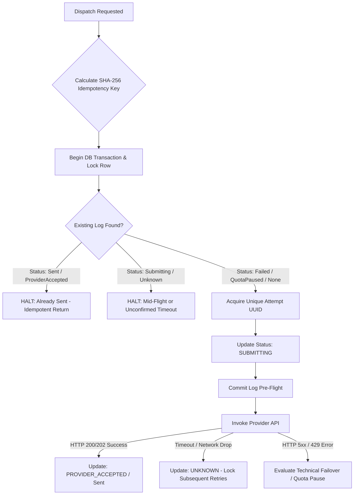

# Email Sending Safety, Idempotency & Delivery Reconciliation

Outbound career applications in JobPilot AI represent critical professional communications. Sending duplicate applications to a hiring manager, recruiter, or ATS is catastrophic to candidate reputation. JobPilot AI implements multi-tiered safety protocols to ensure that emails are sent exactly once or safely halted with zero guesswork.

---

## 1. Zero-Duplicate Architecture

JobPilot AI enforces strict dispatch idempotency at three defensive layers:



### 1.1 SHA-256 Idempotency Key
Every outbound email calculates an immutable deterministic hash before entering queue workers or provider connectors:

$$\text{IdempotencyKey} = \text{hash}\Big(\text{'sha256'}, \text{UserId} : \text{ApplicationId} : \text{implode(',', ToRecipients)} : \text{Subject}\Big)$$

### 1.2 Pessimistic Row Locking (`lockForUpdate`)
During queue execution, workers query existing dispatch logs inside database transactions using pessimistic row locks. This prevents race conditions when concurrent queue workers or web requests attempt to process the same staged outreach.

---

## 2. Timeout Reconciliation Protocol (`UNKNOWN` State)

A primary risk in distributed email systems is **network timeout during provider transmission**:
1. JobPilot AI sends an HTTP request to Gmail API or Microsoft Graph.
2. The remote mail server receives the payload and delivers the email.
3. The HTTP connection drops before JobPilot AI receives the HTTP 200/202 acknowledgment.

### How JobPilot AI Resolves This:
- The attempt is explicitly set to status `UNKNOWN`.
- **Zero-Retries Rule for UNKNOWN State**: Automatic retry and failover engine are **strictly blocked** from re-sending or switching providers when a previous attempt is in `UNKNOWN` status.
- The dispatch raises `RuntimeException: Outreach dispatch status is UNKNOWN (awaiting delivery reconciliation). Halting further automatic dispatches to prevent duplicate transmission to recruiter.`
- The user is alerted on the dashboard to verify whether the email reached the recruiter's inbox before manually clearing or resending.

---

## 3. Global Emergency Stop Integration

JobPilot AI incorporates a global kill switch powered by `EmergencyStopService`:

1. **Pre-Flight Interception**:
   Before provider assignment, allowance checking, or queue dispatch, `AutomaticEmailSwitchingService::dispatchWithFailover()` evaluates:
   ```php
   if ($this->emergencyStop->isEngaged()) {
       throw new RuntimeException('Global Emergency Stop is active. Email outreach is suspended.');
   }
   ```
2. **Immediate Freeze**:
   - Engaging Emergency Stop immediately aborts all active queues.
   - All pending emails remain securely staged in `PendingReview` or `PausedProvider`.
   - No emails are purged, deleted, or sent.
3. **Audit Trail**:
   Every trigger and resume action logs user ID, timestamp, and human rationale.

---

## 4. Anti-Abuse & Anti-Rotation Policy

To safeguard user accounts from spam blacklisting and provider domain bans:
- **No Multi-Account Rotation**: JobPilot AI strictly prohibits rotating through multiple accounts under the same domain/provider (e.g., creating 5 Gmail accounts to bypass the 500 recipient guidance).
- **Shared Pool Protection**: Detects when Google Apps Script and Gmail API belong to the same mailbox, calculating collective quota rather than additive limits.
- **Strict Free Mode**: Paid accounts or automatic billing upgrades are blocked by system policy (`FREE_MODE=true`).

