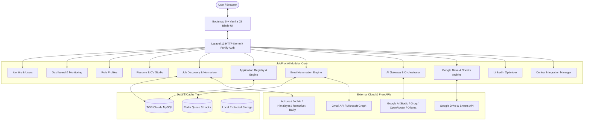

# JobPilot AI — Master Architecture Specification

## 1. Executive Summary
JobPilot AI is architected as a **Secure Modular Monolith** written in PHP 8.3+ on Laravel 13. It leverages TiDB Cloud Starter (MySQL 8.0 protocol) for transactional persistence, Redis for queues and caching, local private storage for active documents, and Google Drive / Google Sheets for long-term historical records and human-readable archives.

## 2. Core Architectural Principles
1. **Free-First Resource Policy (`FREE_RESOURCES_ONLY=true`)**:
   - Strictly prohibits calls to paid models/APIs without verified free tiers and explicit authorization.
   - Dynamic model/quota discovery with graceful provider fallback.
2. **Permanent Identity & Deduplication**:
   - SHA-256 canonical vacancy fingerprints.
   - Registry maintains cross-platform application records permanently even after monthly archiving.
3. **Domain Modular Isolation**:
   - Encapsulated modules communicating via defined Contracts, DTOs, and Domain Events.
   - Thin controllers delegating orchestration to Actions and Services.
   - Strict database ownership: cross-module joins or direct mutation of another module's state is prohibited.
4. **Security & Human-in-the-Loop Safety**:
   - Encrypted provider credentials (`APP_KEY` AES-256-GCM).
   - SSRF-protected external URL fetching.
   - Isolated, shell-escape disabled compilation for LaTeX CVs.
   - Never auto-send without configured mode verification (Manual / Assisted / Automatic with daily limits).

## 3. High-Level System Architecture

## 4. Multi-Tenant / Multi-User Readiness
While initially deployed for personal single-user productivity, every data entity and queue payload includes `user_id` foreign keys and tenant-scoping policies. Transitioning to multi-user requires only enabling public/invite registration in `Settings` without schema rewrites.

